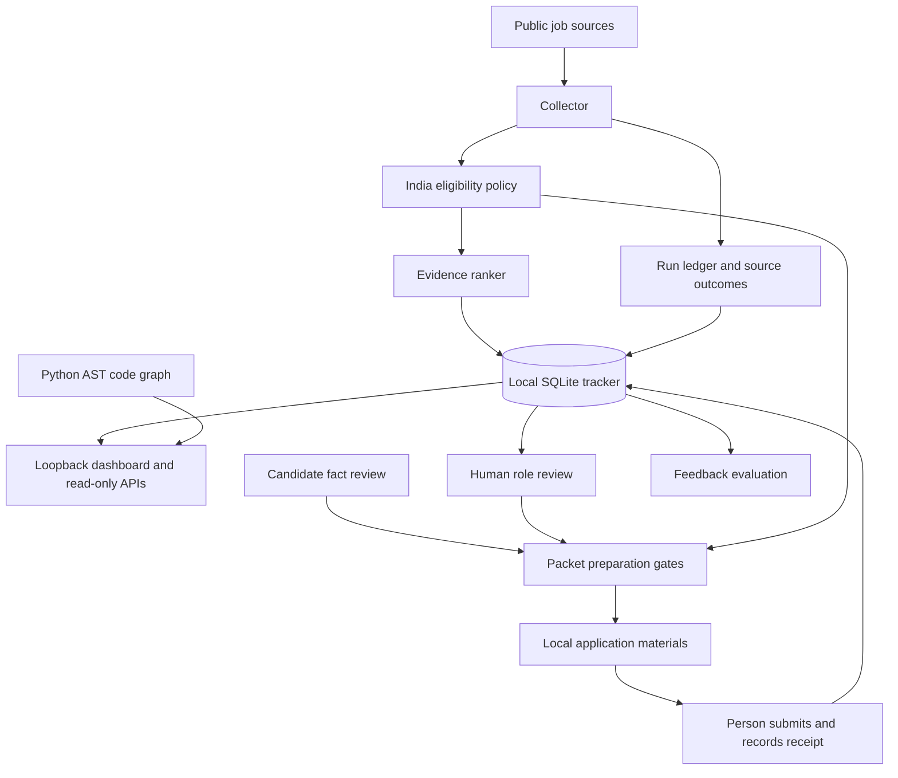

# Agent System Architecture

## Mission

This repository is a supervised job-search agent for roles that are 100% remote and eligible to be worked from India. It discovers and evaluates roles, keeps evidence for application progress, and prepares materials only after role and candidate review. Application submission and recruiter messages remain person-controlled actions.

## Current architecture



The `agent_system` package adds a narrow control plane. Its observation contract and capability catalog are stable machine-readable surfaces. Runtime inspection uses read-only SQLite access and reports only run metadata, candidate fact review completion counts, and code graph health. It does not return candidate profile values or application content.

## Execution model

The main loop is deterministic workflow code with human checkpoints:

1. Discover public listings and retain source outcomes.
2. Reject roles without evidence that the role is fully remote and eligible from India.
3. Rank eligible roles using explicit evidence overlap, not a hiring probability.
4. Record role-fit feedback and compare the saved ranker decision with the latest human label.
5. Prepare local materials only after candidate facts, role approval, and India eligibility pass their gates.
6. The person submits in the employer system and records a receipt. Acknowledgement requires its own evidence.

The run ledger makes workflow progress inspectable. A stale run requires inspection and an explicit recovery record before another instrumented run can start. The scheduler and packet preparation remain separate workflows.

The read-only control plane also derives a short operator action list from aggregate job lifecycle and evidence counts, candidate fact-review completion, ranker evaluation sample sufficiency, run-ledger state, and graph health. It can flag an `APPLIED` row without receipt evidence, recommend reviewing an India-verified shortlist, ask for more role-fit feedback before metrics are interpreted, or direct the operator to inspect a partial run before retrying. These are recommendations only. The control plane does not transition rows, approve roles, tune ranking weights, start workflows, or interact with external agent sessions.

## Capability and risk boundaries

The agent-callable catalog is deliberately small and read-only: inspect local runtime metadata, list the available capabilities, and query the local code graph. The control plane does not provide arbitrary shell execution, browser control, permission approval, application submission, recruiter messaging, or automatic policy edits.

Operator workflows can write to the local database or local application-material directory. Each workflow names its side effects and required gates in `agent_system/system_manifest.json`. The manifest is validated before its capabilities are exposed. This is an agent interface boundary, not an operating-system sandbox. Existing standalone scripts remain executable directly and require the same review discipline in `AGENTS.md`.

## Context, memory, and learning

- `AGENTS.md` holds short, always-active repository constraints.
- `AGENT_SYSTEM_ARCHITECTURE.md` describes the workflow and action boundaries.
- `architecture/repo_graph.json` links Python symbols to source paths. Import edges are extracted from syntax. Resolved call edges are marked inferred and carry their evidence.
- `oracle_ai_local_mirror.db` stores job state, run events, and human feedback locally.
- `adaptive_evaluation.py` reports ranking metrics only when enough labeled examples exist. It does not tune live weights.

The local graph follows Graphify's useful provenance pattern, but it is the repository's existing Python AST graph, not the Graphify package. It does not index PDFs, images, or arbitrary prose. A package install was previously blocked by the sandbox network policy, so no upstream code was installed or executed.

## Observation and recovery contract

Every control-plane response uses `status`, `summary`, `next_actions`, `artifacts`, and `details`. Errors name the cause and a safe next step. Runtime inspection opens SQLite with `mode=ro` and `query_only` enabled. It never initializes schemas, launches subprocesses, or performs network requests.

Use:

```powershell
python -m agent_system.control_plane inspect
python -m agent_system.control_plane capabilities
```

The same information is available from `GET /api/system` and `GET /api/capabilities` after the updated local server starts. Existing processes do not load changed Python modules until restarted from a verified workspace launch path.

## Reference projects and adopted ideas

- [Graphify](https://github.com/Graphify-Labs/graphify): queryable source maps and explicit extracted versus inferred edge provenance. This repository currently uses a smaller standard-library AST graph.
- [Learn Harness Engineering](https://github.com/walkinglabs/learn-harness-engineering): treat instructions, tools, environment, state, and feedback as parts of one harness. The next improvement should be measured by fewer unsafe or repeated actions, not by document count.
- [DeerFlow](https://github.com/bytedance/deer-flow): explicit workflow state, memory boundaries, and sandbox ownership. This repository has persistent state and bounded workflows, but does not yet isolate arbitrary tool execution in a container.
- [AgentGlass](https://github.com/BjoernSchotte/agentglass): make sessions inspectable down to events and process ownership. This repository inspects its own scheduler ledger, not all Antigravity or desktop agent sessions.

## Readiness and next engineering gates

The current foundation does not include a general model planner, a secured arbitrary tool runtime, process-level permission enforcement, or multi-agent coordination. Adding those without an isolated sandbox, tested approval model, and event audit would increase risk. Prioritize:

1. Bring the current server and scheduler onto the instrumented code from a verified launch configuration.
2. Add an offline benchmark set with labeled role-fit cases and source-quality checks.
3. Add a sandboxed execution adapter only if a concrete workflow needs code execution beyond the current fixed Python modules.
4. Add session control only through a supported CLI with explicit, auditable user approval. Never infer permission from a running process.
5. Require measured eval improvement and human review before changing ranking logic.
