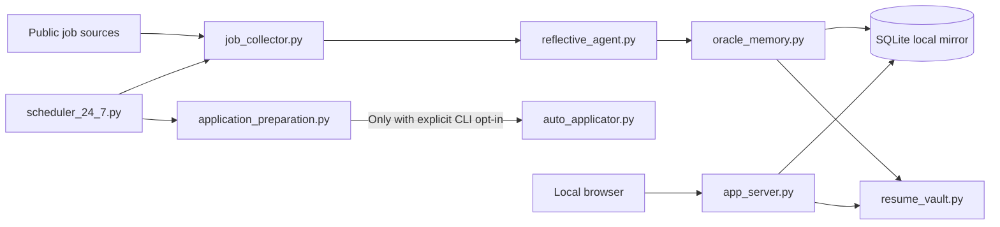
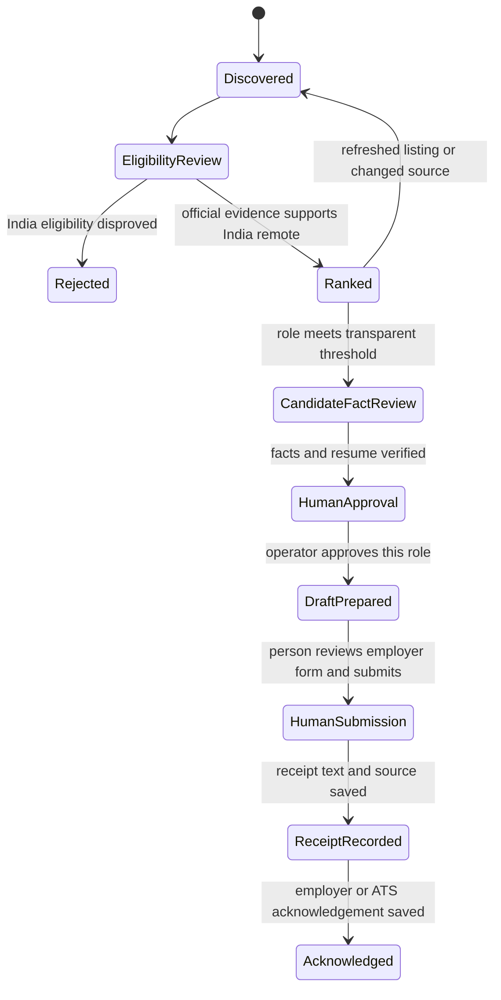

# Agent System Architecture Review

Review date: 2026-09-28

## Executive assessment

This repository is a useful local job-search workflow with a dashboard, scheduled discovery, SQLite memory, a resume vault, and rule-based role ranking. It is not yet a production-grade autonomous agent platform. The core paths exist, but their boundaries, reliability controls, data quality, and runtime visibility are uneven.

The strongest next step is to make the existing workflow inspectable and deterministic before adding more autonomy. That means an explicit workflow model, durable run records, evidence-linked decisions, candidate fact verification, and an operator view of active runs. External applications must remain a human-controlled action.

## Current system map

The production storage observed during this review is SQLite Local Mirror. Oracle connectivity is optional, but the current memory methods still read and write SQLite even when an Oracle connection succeeds. The dashboard is served by Starlette on loopback. The scheduler is a separate process. The collector, scoring, memory, application lifecycle, and API concerns are implemented in a small set of large Python modules.

## Measured application state

These figures were read directly from `oracle_ai_local_mirror.db` through the read-only control-plane inspection on 2026-09-28.

| Measure | Count | Interpretation |
| --- | ---: | --- |
| Stored job rows | 79 | All lifecycle stages |
| Rows at `APPLIED` | 2 | Database workflow status only |
| Rows with submission receipt time and source | 1 | Evidence-backed receipt |
| Rows with acknowledgement time and source | 1 | Acknowledgement evidence exists |
| India eligibility verified | 8 | Evidence status, not necessarily approved or applied |
| India-verified shortlisted | 7 | Listing evidence is verified, role approval is still separate |
| India-verified approved | 0 | No role has been approved |
| Usable role-fit labels for ranking evaluation | 0 | At least 10 are required before metrics are marked measured |
| Dead zone | 15 | Closed records |

The evidence-backed Elastic record has an ATS message saying the application was received. The saved text does not print the job ID, so the association depends on the timeline event and matching timestamp. The database records acknowledgement from that same receipt text. There is no separate recruiter response in the evidence source. The Mastercard row is marked `APPLIED` but has no receipt source or timestamp, so it is not a confirmed submission.

The control-plane summary now exposes these aggregate counts and flags the unconfirmed `APPLIED` row. It also reports that the ranking feedback sample is below the ten-label evaluation threshold. It does not change lifecycle status, evidence, or ranking weights.

## Findings by priority

### P0: Candidate facts are not release-ready

The candidate profile, prior resume material, and current location/work authorization are not consistently verified. Education is also unresolved. The new `candidate_fact_review.json` starts with every required fact unverified. Both the scheduler gate and `auto_applicator.py` now block packet generation until each required fact has a source reference and a dated reviewer attestation. This records a review state, it does not independently prove a claim true. Keep role discovery active while the source-backed review is incomplete.

### P0: Dormant browser and OTP helpers can disclose candidate data

The standalone Playwright helpers can fill employer forms and upload a resume before a person clicks Submit. `overnight_otp_relay.py` can follow Gmail forwarding confirmation links, extract an eight-character code using a broad fallback, write it to a local file, and delete the message. Its account password and bearer token are written to a JSON config without encryption. A source search found no call sites from other Python files, but directly running these scripts can still expose personal data or change mail routing. They were not run during this review. Keep them disabled until credentials are removed, candidate facts are verified, and each external action has a clear human approval step.

### P1: The implemented agent is narrower than its architecture claims

`reflective_agent.py` uses deterministic overlap rules and a lightweight hashed-token vector. The stored critic score is zero, and the configured reflection iteration and critic threshold are not an active maker-checker loop. `architecture_summary.mmd` describes a critic, refiner, automatic skill induction, and Oracle vector memory more broadly than the current execution path supports. Treat scores as heuristics, not probabilities or model judgments. A new aggregate feedback report compares preserved pre-review decisions with human role-fit labels, but it does not measure hiring outcomes or tune scoring weights automatically.

### P1: Oracle connection status does not identify the active data store

`OracleAIMemoryManager` can open an Oracle connection and report Oracle in `backend_mode`, but its schema setup and workflow reads and writes use `local_conn`, which is always SQLite. A successful connection alone does not move job or application data to Oracle. The current live API reports SQLite Local Mirror, but the code could present a misleading backend label when Oracle credentials are configured.

### P1: Scheduled discovery also prepares application materials

Previously, `scheduler_24_7.py` called `run_autonomous_autopilot` after each discovery cycle. Discovery and preparation are now separate commands. An operator must pass `--prepare-approved-materials` as a one-shot action; daemon mode rejects the option. The preparer filters to approved roles with verified India eligibility, and the packet writer separately requires the complete fact-review manifest. Preparation writes candidate materials locally and does not submit them. Separate Playwright helpers can upload resumes to employer sites without submitting the form, so do not treat them as harmless local preparation. The already-running scheduler process still has the old code loaded and needs a controlled restart before the new behavior is active at runtime.

### P1: Eligibility matching is rule-based and needs source review for ambiguous postings

The eligibility policy now lives in `eligibility.py`, rejects several explicit India exclusions and hybrid or onsite indicators before accepting positive phrases, and preserves a short source excerpt. Fifteen focused unit cases cover these branches and the Oportun and Eltropy posting formats. It remains a phrase-based policy. Ambiguous or conflicting source text needs review, with exact URL and capture time persisted alongside the excerpt.

### P1: The local API has no application-level authorization

The server binds to loopback, which limits network exposure, but state and mutation endpoints have no user session, CSRF token, or explicit operator authentication. `/api/state` returns candidate and application data. Keep it loopback-only, add request-origin and CSRF protections for mutation routes, and expose a redacted read model where full personal data is not needed.

### P2: Long-running execution is hard to inspect and recover

The instrumented scheduler now writes durable run IDs, phase events, source outcomes, heartbeats, terminal status, and compact error classes. SQLite permits one instrumented active run. Expired heartbeats become stale and block retries until an operator checks the owner process and records a specific recovery decision. The daemon retries failures with bounded backoff. Processes started before this change do not write ledger events, and the ledger is not an OS process supervisor.

### P2: Data access and workflow logic are tightly coupled

The API constructs the memory manager directly, and the memory manager performs SQLite initialization, optional Oracle connection, graph seeding, compensation enrichment, and application lifecycle transitions. This makes storage migration and isolated workflow verification harder. Split the core domain and workflow from storage adapters and HTTP handlers as a staged refactor, preserving the current SQLite schema through explicit migrations.

## Reference patterns applied

- [Graphify](https://github.com/Graphify-Labs/graphify): local deterministic parsing, queryable graph output, and edge provenance. This repository now has a small standard-library AST graph tool for its Python code. It does not vendor Graphify or claim full language coverage.
- [Learn Harness Engineering](https://github.com/walkinglabs/learn-harness-engineering): persistent operating instructions, an explicit feature list, progress handoff, runtime verification, and workflows drawn as graphs. This review and the new feature/progress files establish that repository-local harness layer.
- [Deer Flow](https://github.com/bytedance/deer-flow): durable long-running task state, scoped memory, execution boundaries, and structured operator input. Adopt those concepts selectively; bringing in a separate framework would add more moving parts than this local workflow currently needs.
- [Agentglass](https://github.com/BjoernSchotte/agentglass): session, tool, process, wait, and error visibility. The dashboard now shows this application's instrumented workflow runs and source events. It does not yet inspect or steer Antigravity, Codex, or other external agent sessions.
- A focused local workflow gate now follows the harness guidance that high-risk actions need a deliberate operator control and deterministic result. Unit checks cover skipped, successful, empty, and failed preparation outcomes.

## Target workflow

The system may discover, normalize, rank, explain, draft, and track. It must not infer a submission from an open form, infer an acknowledgement from a sent message, claim candidate facts without a verified source, or submit an external application without the person's final action.

## Delivery sequence

1. **Truth and controls:** reconcile candidate facts, tighten remote eligibility evidence, mark drafts as unverified, disable unattended OTP handling, and make application preparation and resume upload explicit.
2. **Workflow core:** define typed job, evidence, candidate-fact, and application records; move transitions behind a validated state machine; add versioned SQLite migrations.
3. **Reliable runs:** run IDs, source-level outcomes, heartbeats, single-active-run protection, bounded retry, and explicit stale recovery are implemented for instrumented discovery. Remaining work includes deadlines, idempotency keys, migration tracking, and coordination with older uninstrumented processes.
4. **Operator control plane:** live run state, last runs, source errors, and stale state are visible through the local dashboard and read-only run API. Remaining work includes approval queues, candidate evidence gaps, and process-level supervision. Keep contact data out of this runtime view.
5. **Measured adaptation:** an aggregate report now compares saved predictions with the latest human role-fit label and excludes reviewed roles without a prediction snapshot. Remaining work includes a held-out set, false eligibility-pass evaluation, threshold calibration, and reviewed change history for learned rules.
6. **Modular boundaries:** separate HTTP, workflow, discovery adapters, memory/storage, and generated artifacts without a big-bang rewrite.

## Verification notes and limits

- Database and dashboard counts agree for the live local mirror.
- Existing Python source and the active local API were inspected. The scheduler and app server were running during review.
- Standalone browser and OTP helpers were inspected but not executed. The source search found no Python call sites for them outside their own files.
- The workspace already contained 189 Git changes at review time. Those changes were preserved. This review adds new files only.
- The existing end-to-end script was not run because it performs live discovery and writes database, report, and skill artifacts. Isolated eligibility, preparation-gate, and source-configuration suites ran 26 cases successfully.
- This review does not prove that any application beyond the receipt-backed Elastic record was submitted.

## Runtime observability delta, 2026-09-28

- Added `agent_run_ledger.py` with a single active-run constraint, durable events, heartbeat expiry, and explicit stale recovery.
- Added source outcome counts to the collector and wired run progress into the scheduler. The event log avoids candidate names, contact data, job descriptions, and application packet contents.
- Added `/api/runs` and `/api/runs/{run_id}` plus a dashboard runtime panel. The manual scan view refreshes while the request is active.
- The new code is local only. The running scheduler and server have not been restarted, and the older scheduler instance does not cooperate with the active-run constraint.
- A live GET of `/api/runs` returned 404, confirming the current app server has not loaded the run API. The dashboard now disables manual scans until the instrumented state is present.
- Added pre-review ranker label and score snapshots. The dashboard reports aggregate metrics against the latest human label and excludes records without an original prediction.
- Added `/api/quality`; the report marks samples below ten as insufficient and never adjusts ranker weights automatically.
- Rebuilt the local Python AST graph after the changes: 214 nodes, 528 edges, zero parse errors. The scoped path queries connect the app to the quality evaluator and the scheduler to the run ledger.
- Isolated verification for this delta is recorded in `test_agent_run_ledger.py` and `test_adaptive_evaluation.py`. All 34 scoped tests pass. The existing live discovery script was not run as part of this change.

## Adaptive readiness delta, 2026-09-28

- The read-only control plane now reports 79 stored roles, 8 India-verified roles, 7 India-verified shortlisted roles, 0 approved roles, 2 `APPLIED` rows, 1 receipt-backed submission, and 1 acknowledgement.
- One `APPLIED` row lacks saved submission receipt evidence. The inspection flags it and recommends reconciliation without changing its lifecycle state.
- The ranker has 0 usable human role-fit labels against a 10-label minimum. Metrics remain unmeasured and ranking weights remain unchanged.
- The latest instrumented discovery run ended `PARTIAL`; the control plane recommends inspecting source outcomes and error details before retrying.
- The dashboard now contains a readiness panel for aggregate counts and recommended next actions. A live GET to `127.0.0.1:8080/api/system` still returns 404, so the running app server has not loaded this update. No process was restarted because its verified launch path is unavailable.
- The refreshed local AST graph contains 259 nodes, 622 edges, and zero parse errors. The Graphify package remains uninstalled; the repo uses the local Python graph and adopts explicit edge provenance, query, and path patterns.
- Python AST parsing, JSON parsing, dashboard JavaScript syntax checking, and the text guardrail scan passed. No test suite was run in this update.
